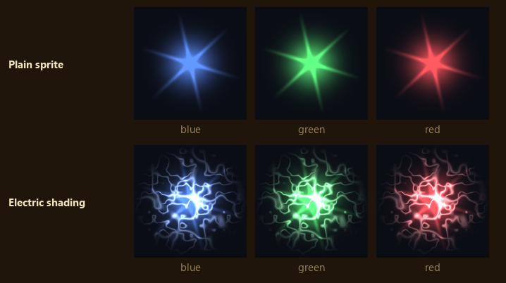
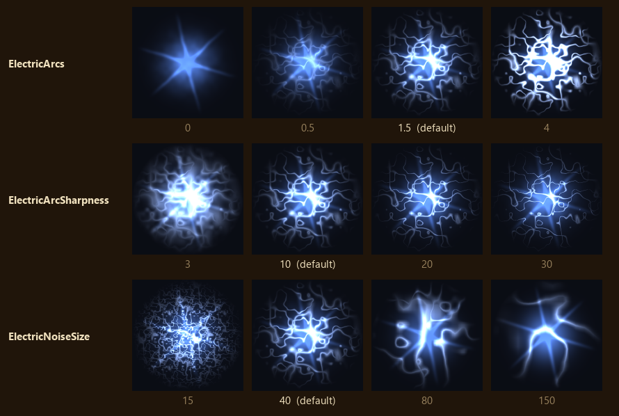
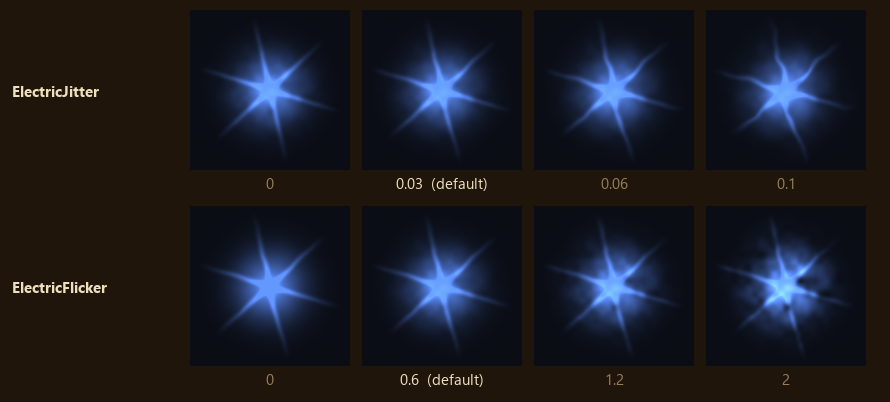
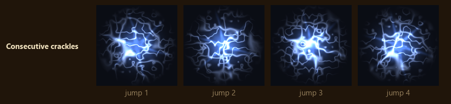
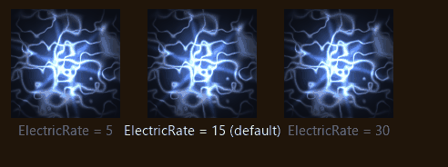
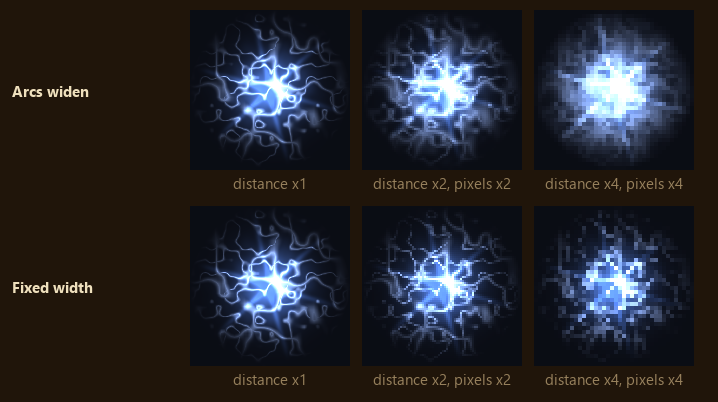

# Electric shading

Arcs take the sprite's own colour halfway to white, so blue, green and red effects keep their hue.

## Arcs

* `ElectricArcs = 1.5` - (Arc brightness. 0 turns the arcs off, leaving jitter and flicker. Past 4
the arcs wash the sprite white.)
* `ElectricArcSharpness = 10` - (Arc thickness. Low values give broad glowing bands, high values thin
threads. Past 30 threads break into dots.)
* `ElectricNoiseSize = 40` - (World units across one tile of arc noise. Smaller gives more, closer
arcs. It is measured in the world, not per sprite, so a big effect carries more arcs than a small
spark.)

## Jitter and flicker

* `ElectricJitter = 0.03` - (How far the texture jumps each crackle, in texture widths. It bends the
flare's rays and edges.)
* `ElectricFlicker = 0.6` - (How far brightness swings, as a fraction. It varies across the sprite
and from crackle to crackle. Past 2 the dim patches go black.)

## Crackle rate

Each crackle moves the noise to a fresh spot, so arcs, jitter and flicker all change at once.

* `ElectricRate = 15` - (Crackles per second. 0 freezes the arcs in place. Above the frame rate
every frame crackles, so higher values look the same.)

## Distance

The pitched camera sees the top of the screen from much further away than the bottom, and zooming
out moves everything further still. Past the default camera's distance, `CameraHeight` over the
sine of `CameraPitch`, arcs widen with distance so they stay at least a pixel or two wide. Without
that they would thin to broken, shimmering dots.

There is no key for this. It follows `CameraHeight` and `CameraPitch`.

