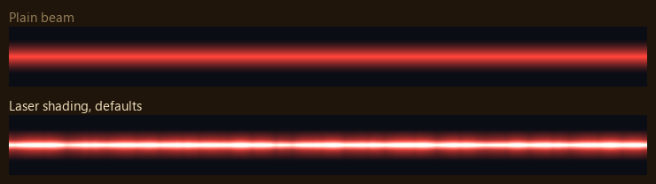
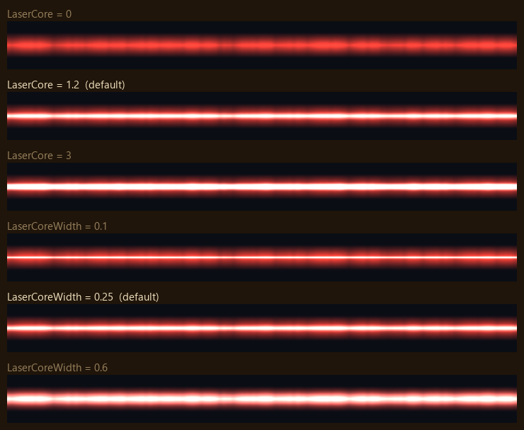
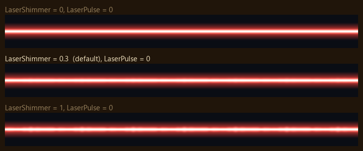
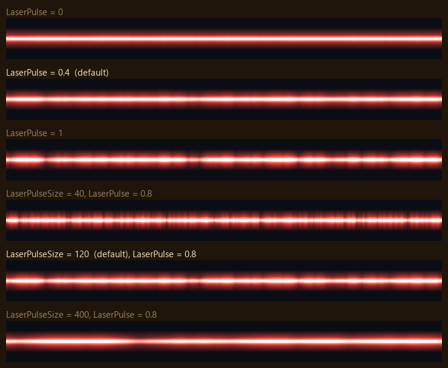
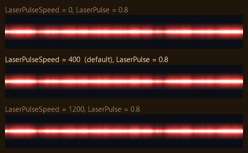
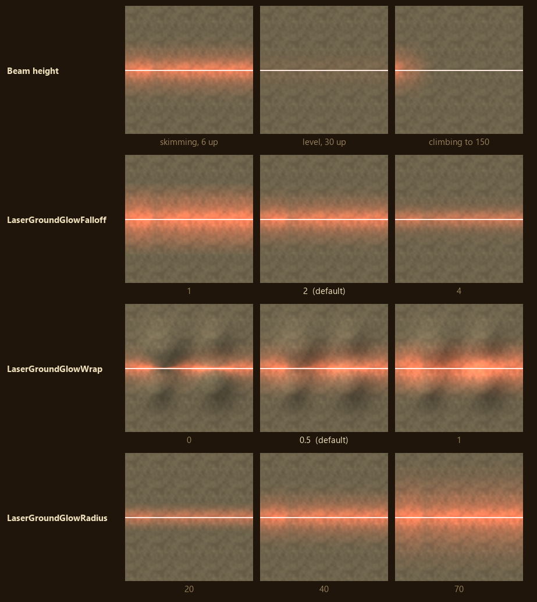

# Laser shading

The beam's own texture still gives its colour and shape. The shader adds the white-hot core, the
pulses and the soft edges.

## Core

* `LaserCore = 1.2` - (Core brightness. 0 turns the core off.)
* `LaserCoreWidth = 0.25` - (Core width, as a fraction of the beam's half width.)

* `LaserShimmer = 0.3` - (How far the core's width wavers along the beam, as a fraction. 0 keeps it
steady, 1 at most.)

## Pulses

* `LaserPulse = 0.4` - (How far brightness swings along the beam, as a fraction. 0 is steady.)
* `LaserPulseSize = 120` - (World units across one tile of pulse noise. Smaller gives more, shorter
pulses.)

* `LaserPulseSpeed = 400` - (World units a second the pulses travel towards the target. 0 freezes
them. Pulses are fixed along the beam, so they keep flowing smoothly while the shooter moves.)

# Laser ground glow

Each beam lights the ground with one light shaped like the beam. The ground takes the light at its
distance from the nearest point on the beam, measured in three dimensions. Pictures are seen from
above, with the beam drawn as a white line.

* Beam height - (A beam skimming the ground lights a bright strip. A level beam high above the
ground lights little. A beam climbing into the sky lights only the ground near the shooter.)
* `LaserGroundGlowFalloff = 2` - (How fast the light fades with distance from the beam, as a power.
Higher gives a tight bright core, lower a broad wash.)
* `LaserGroundGlowWrap = 0.5` - (Light on ground facing away from the beam, from 0 to 1. 0 lights
only slopes facing it, so hills show dark backs. 1 lights all ground evenly.)
* `LaserGroundGlowRadius = 0` - (How far the light reaches from the beam, in world units. 0 takes
1.25 times the laser's `OuterBeamWidth`, at least 15. `GroundGlowRadius` on the `W3DLaserDraw`
module overrides it for one laser.)

The glow's colour and strength come from `LaserGroundGlowColor` and `LaserGroundGlowIntensity`,
described under [Laser ground glow](contraZH-Options.md#laser-ground-glow).

