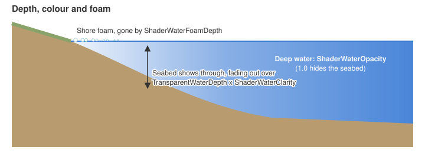
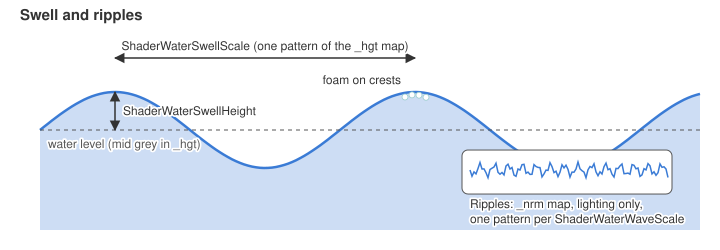
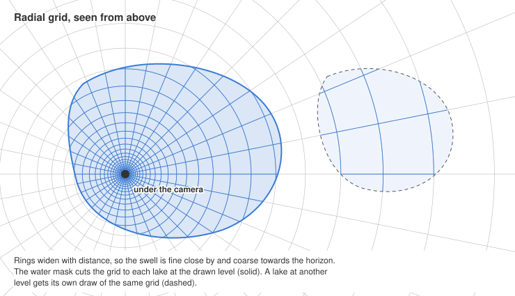
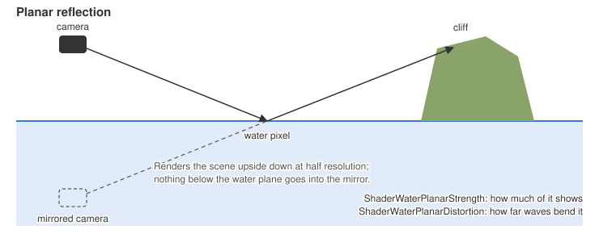

# Water.ini

The water colour and texture still come from `StandingWaterColor`, `StandingWaterTexture` and the
time of day `DiffuseColor`. On shader model 3 cards the texture gives only its average colour, and
`ShaderWaterDeepColor` can replace that. Tuned in the `WaterTransparency` block of `Water.ini`, and
per map in `map.ini`. WorldBuilder Qt edits a map's keys live under File > Map.ini > Water tuning.

Cheat builds reload `Data\INI\Water.ini` about half a second after it is saved, so the water can be
tuned with a map running. The saved values win over the map's `map.ini` until the map loads again.
A deleted key keeps its value until a restart, skybox textures need a restart, and a file with an
error is skipped until the next save.

## Main keys

These set the look of most maps. The rest are under [Advanced keys](Water-Key-Reference.md#advanced-keys).

* `ShaderWaterOpacity = 0.95` - (Opacity of deep water. 1 hides the seabed.)
* `ShaderWaterClarity = 1.0` - (How deep the seabed shows. Higher sees deeper.)
* `ShaderWaterDeepColor` - (Colour of deep water, as `R:0-255 G:0-255 B:0-255`. Unset takes the
average colour of `StandingWaterTexture`. The map's light and `DiffuseColor` still tint it. Shader
model 3 only.)
* `ShaderWaterWaveScale = 160` - (World units one wave pattern covers. Higher gives broader waves.)
* `ShaderWaterWaveStrength = 0.2` - (Steepness of the waves. Drives glint, sparkles, reflection and
bending.)
* `ShaderWaterSpecular = 1.0` - (Brightness of the broad sun glint. 0 turns it off.)
* `ShaderWaterSparkle = 0.6` - (Brightness of the small sun specks, times the map's light, sun and
ambient together. 0 turns them off. The specks are a narrow highlight off the ripples, from a sun
ahead of the camera, so they show from every view. More of them show as `ShaderWaterWaveStrength`
rises. Shader model 3 only.)
* `ShaderWaterReflection = 3.0` - (Scales the sky reflection. 0 turns it off.)
* `ShaderWaterSwellHeight = 0.0` - (Height of the vertex waves that lift lakes and seas, in world
units. 0 turns them off. Needs a shader model 3 card.)
* `ShaderWaterFoamStrength = 0.15` - (Brightness of the foam. 1 is full white web, 0 turns foam off.)
* `ShaderWaterAutoMeasure = No` - (Calms water by its distance from shore, so ponds, harbours and
rivers are calmer than open sea. See [Open water](#open-water).)
* `ShaderWaterEnclosedCalm = 0.8` - (How much calmer enclosed water is, 0 to 1. At 1 it keeps 40% of
the wave strength, half the broad waves and 20% of the swell.)
* `ShaderWaterZoomCompensation = Yes` - (Keeps the ripples and sun specks as they look up close at any
zoom and camera pitch. Zoomed out, the ripples double in size each time a pixel covers twice the
ground, so their detail never filters away, and the specks glint off a sun just below the view's
own height. No keeps the ripples at `ShaderWaterWaveScale` and the specks off the map sun's height.
Shader model 3 only.)

## Advanced keys

### Depth and colour

* `TransparentWaterDepth = 3.0` - (Depth over which the seabed fades out, and over which the
reflection, glint and foam fade in from the shoreline, so the water meets the ground without a
line. 0 gives a hard shore edge. `ShaderWaterClarity` scales it. Same key as the old water.)
* `TransparentWaterMinOpacity = 1.0` - (Opacity of deep water for the old water, and for shader
water when `ShaderWaterOpacity` is 0.)
* `ShaderWaterTexturePattern = 0.1` - (How much of `StandingWaterTexture`'s pattern shows over the water
colour, 0 to 1. The pattern keeps `ShaderWaterDeepColor` as its average. 1 with no deep colour set,
`ShaderWaterWaveShading = 0` and `ShaderWaterSparkle = 0` gives the shader model 2.0a look with the
four wave layers. Shader model 3 only.)
* `ShaderWaterFoamDepth = 6` - (Depth where shore foam fades out. 0 turns foam off, crest foam
included. Pier walls, jetties and cliffs rising out of deep water gather foam within 15 world units.)
* `ShaderWaterShoreFoamDepth = 3.0` - (Depth the shoreline foam band reaches at the top of its surge.
Gentle shores show the band wider than steep ones. Needs `ShorelineFoam` in Options.ini. Shader model
3 only.)
* `ShaderWaterShoreFoamSurge = 0.4` - (Share of the shoreline foam band the surge pulls back, 0 to 0.9.
0 holds the band still.)

### Surface

These keys control the glint and how far the waves bend the seabed. The inset in the swell picture
below shows the ripple pattern.

* `ShaderWaterSpecularSpread = 0.3` - (Widens the sun glint. The glint is the sun's reflection, so it
only shows when the camera looks toward the sun, and most maps light from behind the default view.
A wider glint catches more view angles and turns from a sharp sparkle into a broad sheen. Raise
`ShaderWaterSpecular` with it to keep the glint bright.)
* `ShaderWaterVirtualSun = Yes` - (Yes glints off a sun placed ahead of the camera at the map sun's
height, so the glint shows from every view. The glint then turns with the camera and no longer
matches the direction of shadows and lighting. Only the glint moves.)
* `ShaderWaterRefraction = 0.015` - (How far the waves bend the seabed, as a fraction of the screen.)
* `ShaderWaterWaveShading = 0.1` - (How much the waves light and shade the water's own colour, so
they show from straight above where the reflection is weak. 0 leaves the colour flat. Shader model 3
only.)

On shader model 3 cards the waves come in four layers, from swells over two and a half ripple
patterns wide down to chop a sixth of one, each drifting its own way.

### Open water

Waves grow with the open water the wind crosses, so ponds lie glassy, harbours stay small and
choppy, and open sea rolls. With `ShaderWaterAutoMeasure` the game measures every map cell's
distance to dry ground and calms the water near shore by `ShaderWaterEnclosedCalm`. The other keys
set the open sea's look. Rivers count as enclosed. The distances are measured again when scripts
raise or lower water or the terrain changes. Shader model 3 only, and the distance reading needs
vertex texture support.

* `ShaderWaterOpenReach = 371` - (World units from shore at which water counts as fully open. The
enclosed look fades into the open look over this distance. Distances stop at 2550.)

### Tiling

The ripples and the foam repeat on a fixed grid, which shows as a pattern across a large lake or
sea. Stochastic texturing hides it. The water is split into hex cells, each cell shifts and turns
the patterns by its own random amount, and every point blends the three nearest cells while keeping
the patterns' contrast. The waves travel the same way in every cell.

* `ShaderWaterStochasticSize = 502` - (World units between neighbouring cells. Smaller breaks the
pattern up more but blends more of the surface. 0 turns it off.)
* `ShaderWaterStochasticSeabed = Yes` - (The same cells also shift and turn the terrain textures under
standing water, fading in below the waterline over `TransparentWaterDepth`. Cliffs keep their own
texturing, and ground under rivers is left as it is. Terrain chunks with standing water draw through
their own shaders, which take three point lights instead of eight. No turns it off. The same tiling can
be painted onto dry ground; see [Stochastic terrain](dx9-Terrain.md#stochastic-terrain).)

### Animation

* `WaterAnimationFps = 30` - (Moves the water as if the game ran at this rate, 30 to 60. 30 gives the
original speed. 0 moves the water every frame, so it speeds up with the frame rate when the game
logic is uncapped.)

### Swell

* `ShaderWaterSwellScale = 700` - (World units one swell pattern covers. Higher gives longer swells.)
* `ShaderWaterSwellSpeed = 30` - (World units a second the swell drifts. 0 holds it still.)

The waves reach full height in water twice `ShaderWaterSwellHeight` deep and flatten towards the
shore, so their troughs never sink below the seabed. The swell rides nested square grids centred
under the camera, each with cells twice the size of the one inside it, so it is fine close by and
coarser towards the horizon. Each grid snaps to its own world lattice, so moving the camera never
makes the waves shift or shimmer. The grids cover every flat lake and sea at a level, cut to their
outlines per map cell and one cell wider, so the cut falls on dry land and the shore fades as drawn.
Standing water whose points differ in height by more than a unit keeps its own grid, and rivers stay
flat.

### Reflection

* `ShaderWaterClearReflections = Yes` - (Unit, building and cliff shadows leave the sky and mirrored
scene in the water as bright as around them, as a shadow takes only the sun's light away. They still
darken the water's own colour and hide the glint and specks. No dims the reflections in shadow too.
Shader model 3 only.)
* `ShaderWaterSoftShadows = Yes` - (Shadows in the water blur with depth, up to 4 world units, and
sway with the ripples, as sunlight scatters through the water. No keeps them as sharp as on the
ground. Shader model 3 only.)

* `ShaderWaterPlanarStrength = 0.3` - (Reflection the mirrored scene adds on top of the sky's. 0
leaves the mirror only at grazing angles. Water at another height than the one under the view fades
to the skybox over 4 world units.)
* `ShaderWaterPlanarDistortion = 0.025` - (How far the waves bend the mirrored scene, as a fraction of
the screen. It follows the wave slopes, so `ShaderWaterWaveStrength` and calmer enclosed water scale
it too. 0 keeps the mirror sharp.)

### Retired keys

These keys still load but do nothing, as the water uses fixed values for them:
`ShaderWaterShallowColor`, `ShaderWaterSparkleSize`, `ShaderWaterSparkleSpread`,
`ShaderWaterEnclosedWaves`, `ShaderWaterEnclosedWaveScale`, `ShaderWaterEnclosedSwell`,
`ShaderWaterEnclosedColor`, `ShaderWaterStochasticSharpness`, `ShaderWaterStochasticRandom`,
`ShaderWaterStochasticRotation`, `ShaderWaterFoamReach`, `ShaderWaterFoamScale` and
`ShaderWaterPlanarFade`.

